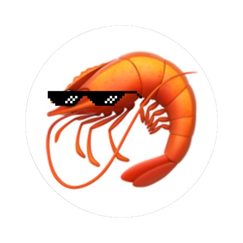

  

<h1 align="center">krillion't</h1>

  Highest-scoring Daily Dive answers, right inside Krillion.

  <a href="#installation">Installation</a> ·
  <a href="#how-it-works">How it works</a> ·
  <a href="./krilliont.user.js">Userscript</a> ·
  <a href="./LICENSE">MIT License</a>

  Not sure why you'd want to cheat at a daily word game, but here we are.

---
## Installation

1. Install [Tampermonkey](https://www.tampermonkey.net/).
2. Open [`krilliont.user.js`](./krilliont.user.js) and click **Raw**.
3. Confirm installation in Tampermonkey.
4. Open or refresh [krillion.io](https://krillion.io/).

Alternatively, create a new script in Tampermonkey, paste the file's contents, and save.

## How it works

The script requests the current daily puzzle from `/api/today`,
then retrieves its answer data from `/api/reveal?date=YYYY-MM-DD`.

For each prompt, it displays the answer with the highest score.
If multiple answers share that score, it displays the first one returned.

## Scope and limitations

- Supports the current Daily Dive only.
- Displays Daily answers even when another game mode is open.
- Downloads the full daily answer response on each page load.
- Does not submit answers or scores.
- Depends on undocumented endpoints that may change or become unavailable.

## Privacy

The script adds no analytics and sends no data to its developer.
Its network requests go directly from your browser to Krillion.

Krillion's own privacy policy still applies to those requests.

## Disclaimer

This is an unofficial project, not affiliated with or endorsed by Krillion.

Technical access to an endpoint does not imply permission to use its data
for every purpose. You are responsible for checking applicable rules and
permissions before using the script.

## License

The original code in this repository is licensed under the [MIT License](LICENSE).

This license does not cover Krillion's answer data, branding, fonts,
or other third-party materials.
